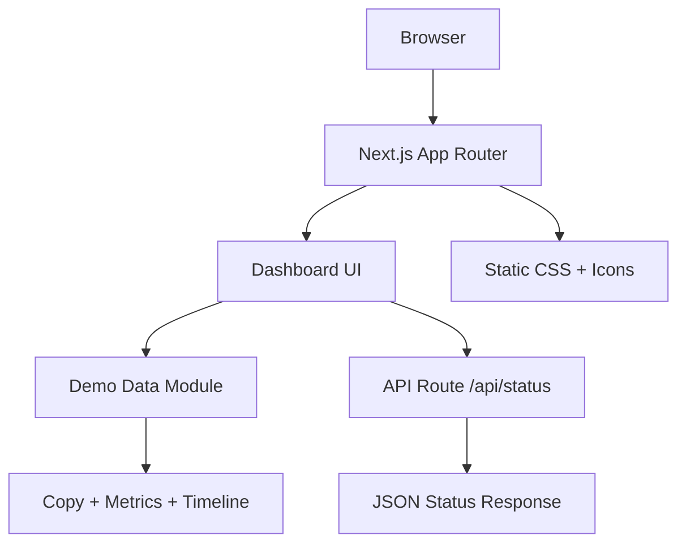

# LoveLife Ops — Architecture

## Product intent

A playful, modern single-page dashboard that looks like a serious operations console while delivering a harmless work-life-balance joke.

**Important design constraint:** every telemetry value is fictional demo data. The project must not infer, scrape, monitor, or store another person's private relationship information.

## System diagram

## Layers

| Layer | Responsibility | Location |
|---|---|---|
| UI | Page composition, interaction, responsive behavior | `components/dashboard.tsx` |
| Presentation | Global tokens, layout, typography, motion | `app/globals.css` |
| Domain/demo data | Fake metrics, timeline events, joke recommendations | `lib/mock-data.ts` |
| API | Lightweight health/status endpoint | `app/api/status/route.ts` |
| App shell | Metadata and route entry | `app/layout.tsx`, `app/page.tsx` |
| Documentation | Setup, boundaries, architecture | `README.md`, `docs/ARCHITECTURE.md` |

## UX architecture

1. **Hero / punchline** — establishes that this is a demo dashboard, not surveillance.
2. **Metric cards** — turns the joke into an enterprise-looking monitoring surface.
3. **Runtime terminal** — creates the “advanced system” feel.
4. **Suggested patches** — delivers the jokes as software recommendations instead of personal criticism.
5. **Fictional event stream** — gives the screen depth without claiming real events.

## Privacy / safety boundary

The application deliberately excludes:

- dating-app integrations
- scraping social media
- relationship-status inference
- age tracking
- personal contact lists
- location tracking
- persistent profiles

The name shown in the UI is only a presentation label for the joke. All metrics are mocked.

## Deployment shape

The app is intentionally serverless-friendly. It can be deployed as a normal Next.js app on a platform that supports Node/Next.js. No database is required.

## Suggested future enhancements

- dark/light mode toggle
- animated “incident” drawer
- printable one-page roast report
- shareable screenshot mode
- accessibility pass with keyboard-first interactions
- server-side feature flags for demo copy
